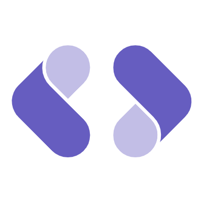

<p align="center">
  
</p>

<h1 align="center">CodeDesign for ChatGPT, Claude, Cursor and other AI apps</h1>

<p align="center">
  Build, edit and publish websites with AI, right from the chat you already use.<br>
  <a href="https://codedesign.ai">codedesign.ai</a>
</p>

---

CodeDesign is an AI website builder. This repository holds the public connection details for the **CodeDesign MCP server**, a hosted server that lets AI apps work with your CodeDesign account. There is nothing to install or run: you add one link to your AI app and sign in with CodeDesign.

```
https://mcp.codedesign.ai/mcp
```

- **Transport:** Streamable HTTP (remote, hosted by CodeDesign)
- **Sign-in:** OAuth 2.1 with your CodeDesign account (PKCE, dynamic client registration). No API key to copy.
- **Official MCP Registry name:** `ai.codedesign/codedesign`

## What you can do

Ask in plain words, for example:

- "Build a website for my bakery with a booking page."
- "Change the homepage headline to *Fresh bread every morning* and publish it."
- "Which of my sites have SEO problems?"
- "Show me the latest form submissions from my contact page."
- "Search for a domain for my coaching business."

The server covers the main parts of CodeDesign:

| Area | What the AI can do |
| --- | --- |
| Sites | List your workspaces and sites, create a site with AI, save designs, publish |
| Pages | Read and edit pages, add or manage pages, restore an earlier version |
| AI changes | Start an AI task on a site, answer its questions, check its progress |
| Growth | Run an SEO audit, read analytics, read form submissions |
| Extras | Domains, blog posts, chatbot, cookie banner, forms, templates |
| Account | Plan and usage, team and site access |

Actions that change or publish a site follow your CodeDesign permissions. Deleting a site always asks for its exact name first. Anything that needs payment returns a link to CodeDesign's own checkout page; the AI never takes payment.

## Connect it

### ChatGPT
Settings → Apps & Connectors → Create (developer mode) → paste `https://mcp.codedesign.ai/mcp` → sign in with CodeDesign.

### Claude (claude.ai and Claude Desktop)
Settings → Connectors → Add custom connector → paste `https://mcp.codedesign.ai/mcp` → Connect → sign in with CodeDesign.

### Claude Code
```bash
claude mcp add --transport http codedesign https://mcp.codedesign.ai/mcp
```
Then run `/mcp` inside Claude Code and choose **codedesign** to sign in.

### Cursor
[Add to Cursor](cursor://anysphere.cursor-deeplink/mcp/install?name=codedesign&config=eyJ1cmwiOiJodHRwczovL21jcC5jb2RlZGVzaWduLmFpL21jcCJ9), or add this to `~/.cursor/mcp.json`:

```json
{
  "mcpServers": {
    "codedesign": {
      "url": "https://mcp.codedesign.ai/mcp"
    }
  }
}
```

### VS Code (GitHub Copilot)
```bash
code --add-mcp '{"name":"codedesign","type":"http","url":"https://mcp.codedesign.ai/mcp"}'
```

### Windsurf
Add to `~/.codeium/windsurf/mcp_config.json`:

```json
{
  "mcpServers": {
    "codedesign": {
      "serverUrl": "https://mcp.codedesign.ai/mcp"
    }
  }
}
```

### Gemini CLI
```bash
gemini extensions install https://github.com/codedesignapp/mcp
```

### Any other app
Any app that supports remote MCP servers over Streamable HTTP with OAuth can use `https://mcp.codedesign.ai/mcp`.

## What's in this repository

| File | Purpose |
| --- | --- |
| `server.json` | Listing for the [official MCP Registry](https://registry.modelcontextprotocol.io/v0.1/servers?search=ai.codedesign) |
| `gemini-extension.json` | Gemini CLI extension manifest |
| `logo.png` | 400 × 400 logo for directories |

The server itself is hosted and maintained by CodeDesign; its source code is not in this repository.

## Help

- Website: https://codedesign.ai
- Support: support@codedesign.ai
- Bugs or questions about the connection: [open an issue](https://github.com/codedesignapp/mcp/issues)
